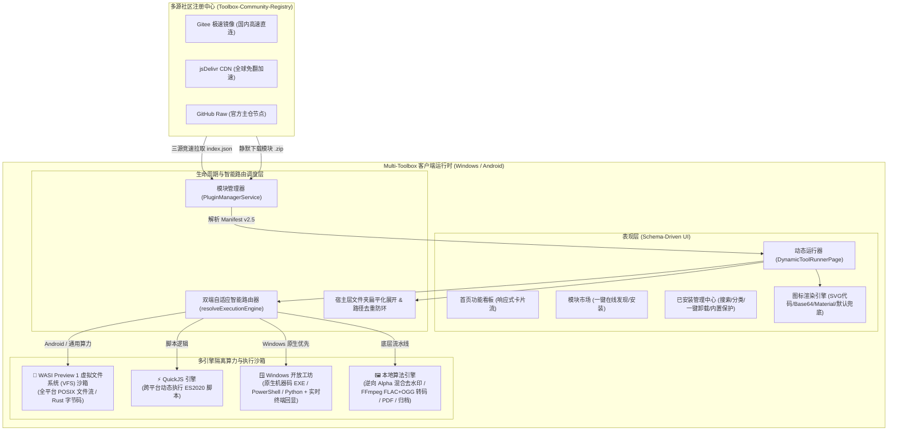

# 🛠️ Multi-Toolbox 社区功能模块（插件）全栈开发与技术架构指南 (Manifest v2.5)

> **当前规范版本**：`Manifest v2.5` (声明式 banners / rejectedExtensions、交互式拾色与图片对比、非阻塞异步网络 Host Bridge、Path Jail 安全围栏、WASI Preview 1 VFS 与免打包本地热调试)
> **适用对象**：核心维护人员、第三方工具开发者、系统与脚本工程师（Rust / C++ / WebAssembly / JavaScript / Python / CLI）  
> **核心哲学**：**客户端极致精简稳定，海量功能按需沙箱热插拔；100% 纯本地离线执行，全面保障用户隐私与数据安全。**

---

## 目录 (Table of Contents)

1. [系统整体架构与沙箱底座全貌](#1-系统整体架构与沙箱底座全貌)
2. [五大执行模式与运行时深度解析](#2-五大执行模式与运行时深度解析)
   - [2.1 WebAssembly (Wasm) 二进制算力与 WASI Preview 1 虚拟文件系统 (VFS) 沙箱](#21-webassembly-wasm-二进制算力与-wasi-preview-1-虚拟文件系统-vfs-沙箱)
   - [2.2 QuickJS 跨平台动态脚本沙箱与宿主 Bridge (Async Network, Path Jail, Binary I/O & Image Pipeline)](#22-quickjs-跨平台动态脚本沙箱-executiontype-quickjs)
   - [2.3 Windows 开放扩展工坊 (Native CLI / Script)](#23-windows-开放扩展工坊-executiontype-native_executable--script)
   - [2.4 🚀 双端自适应合一架构 (Dual-Adaptive: Win 原生 + Android WASM)](#24--双端自适应合一架构-dual-adaptive-win-原生--android-wasm)
   - [2.5 客户端内置原生算法与多媒体流水线 (Audio & Image Pipeline)](#25-客户端内置原生算法与多媒体流水线-executiontype-internal)
3. [Manifest v2.5 清单规范全字段完整参考](#3-manifest-v25-清单规范全字段完整参考)
   - [3.1 核心元数据配置](#31-核心元数据配置)
   - [3.2 图标系统完整规范 (图片限制与 SVG 矢量代码渲染)](#32-图标系统完整规范-图片限制与-svg-矢量代码渲染)
   - [3.3 动态表单组件系统 (Inputs)](#33-动态表单组件系统-inputs)
     - *文件选择器特性：图片交互缩略图预览、Android 专有后缀容错、文件夹递归展开与符号链接防死循环*
     - *其他组件：switch 开关、slider 滑块、select 下拉单选、text 文本框*
   - [3.4 动态条件联动展示 (visibleIf) 高级语法 (and / or / in)](#34-动态条件联动展示-visibleif)
   - [3.5 完整的 dual-adaptive 双 Runner 声明结构](#35-完整的-dual-adaptive-双-runner-声明结构)
4. [从零开始的实战开发教程 (4 个完整实例)](#4-从零开始的实战开发教程-4-个完整实例)
   - [实战 1：开发一个 QuickJS 文本高频词分析与多重编解码模块](#实战-1开发一个-quickjs-文本高频词分析与多重编解码模块)
   - [实战 2：开发一个 Rust 编译的 WebAssembly 极速素数筛/哈希计算模块](#实战-2开发一个-rust-编译的-webassembly-极速素数筛哈希计算模块)
   - [实战 3：开发一个 Windows 独立 CLI 音视频转码与终端回显扩展](#实战-3开发一个-windows-独立-cli-音视频转码与终端回显扩展)
   - [🌟 实战 4：开发一个双端自适应合一插件（网易云 NCM 解密器）](#-实战-4开发一个双端自适应合一插件网易云-ncm-解密器)
5. [本地开发、热调试、打包与自动化测试规范](#5-本地开发打包与自动化测试规范)
   - [5.1 🌟 关联本地开发目录：免打包实时热调试 (Dev Link Mode)](#51--关联本地开发目录免打包实时热调试-local-dev-link-mode)
   - [5.2 运行期「开发者调试抽屉 (Dev Drawer)」可观测性中枢](#52-运行期开发者调试抽屉-dev-drawer-可观测性中枢)
   - [5.3 QuickJS 报错行号偏移补偿与 SourceMap 解析](#53-quickjs-报错行号偏移补偿与-sourcemap-解析)
   - [5.4 WASI Panic 结构化回显](#54-wasi-panic-结构化回显)
   - [5.5 分块流式传输与大文件零内存拷贝 (Chunked VFS Transfer)](#55-分块流式传输与大文件零内存拷贝-chunked-vfs-transfer)
   - [5.6 注册中心 GitHub Actions 跨平台交叉编译矩阵](#56-注册中心-github-actions-跨平台交叉编译矩阵)
   - [5.7 运行本地自动化构建与一致性校验](#57-运行本地自动化构建与一致性校验)
6. [社区注册中心提交与合入发布规范 (PR 流程)](#6-社区注册中心提交与合入发布规范-pr-流程)

---

## 1. 系统整体架构与沙箱底座全貌

Multi-Toolbox 采用 **“宿主容器（Host Container）+ 声明式 Schema 驱动 UI + 多引擎隔离沙箱（Sandboxed Runtimes）+ 多源分布式注册表（Registry）”** 的现代化分层架构。



### 为什么开发者无需为客户端重新发版？
1. **界面全声明化**：开发者无需编写 Flutter Widget。只需在 `manifest.json` 中以 JSON 声明输入表单（文件选择、滑块、下拉选择、联动条件等），客户端在运行时自动渲染。
2. **多沙箱直接执行**：无论是编译好的 WebAssembly 二进制还是 JS 脚本，均能在客户端沙箱中离线运行，零发版周期。
3. **双端自适应合一 (Dual-Adaptive)**：一个插件包同时容纳 Windows 原生二进制与 Android WASM 字节码，客户端根据操作系统自动选择最优执行链路，兼具极致性能与全平台便携性。
4. **安全隔离与无感更新**：模块以独立的 `.zip` 包发布与缓存。新增、更新或卸载功能，只需操作对应的模块目录，绝不影响客户端本体。

---

## 2. 五大执行模式与运行时深度解析

开发者可根据任务特点与技术栈，在 `manifest.json` 中灵活选择执行模式：

| 执行模式 (`executionType`) | 核心技术栈 | 跨平台支持 | 适用典型场景 |
| :--- | :--- | :---: | :--- |
| **`wasm` (WASI CLI / VFS)** | C / C++ / Rust / Go (`wasm32-wasip1`) | 🌐 Windows / Android 全兼容 | 密集计算、二进制流转换、音视频音频解密、大文件流式加解密 |
| **`quickjs`** | JavaScript (ES2020) | 🌐 Windows / Android 全兼容 | 纯文本分析、数据清洗、正则解析、轻量算法规则 |
| **`native_executable` / `script`** | CLI 可执行程序、PowerShell、Python | 🪟 Windows 专享 | 挂接现成大型 Windows 命令行工具（如 ffmpeg, yt-dlp, pandoc） |
| **🚀 双端自适应合一 (Dual-Adaptive)** | Win 原生 EXE + Android WASM | 🌐 双端最优解 | **强烈推荐**：Windows 跑裸机原生二进制（0.3s 直出），Android 跑 WASM 沙箱（<1s 完成） |
| **`internal`** | 客户端底层图形/音视频引擎 | 🌐 Windows / Android 全兼容 | 逆向 Alpha 混合去水印、FFmpeg 原生转码（新增 FLAC / OGG）、PDF 矢量重构 |

---

### 2.1 WebAssembly (Wasm) 二进制算力与 WASI Preview 1 虚拟文件系统 (VFS) 沙箱

在最新架构中，Multi-Toolbox 将底座升级为支持 **WASI Preview 1 规范与虚拟文件系统 (VFS)** 的高性能引擎（基于 Rust `wasm_run` 底座，预编译包含全架构原生动态库）：

#### 核心技术优势：
- **物理磁盘虚拟目录映射**：
  客户端自动将宿主主机的真实工作路径无缝挂载为沙箱内部的标准 POSIX 路径：
  - 宿主输入文件父目录 $	o$ 沙箱 `/input`
  - 宿主任务输出目录 $	o$ 沙箱 `/output` 及当前工作目录 `.`
  - 宿主临时目录 $	o$ 沙箱 `/tmp`
- **真正的流式 I/O**：
  C/C++（`fopen` / `fread` / `fwrite`）或 Rust（`std::fs::File`）编译到 `wasm32-wasip1` 目标后，标准 I/O 调用直接桥接到宿主磁盘。百兆级别音频与大型二进制文件可直接以 1MB~4MB 分块流式读写，彻底告别旧版 QuickJS/纯内存传输引发的内存暴涨与 UTF-8 乱码限制。
- **CLI 批处理全生命周期调度**：
  支持 `executionMode: "wasi_cli"`，自动寻找 `_start` 入口，支持参数占位符模板（如 `-i {input} -o {outputDir}`）与 `batchMode: true` 自动多文件流式批处理。

#### Manifest 配置结构：
```json
{
  "executionType": "wasm",
  "engineType": "wasm",
  "wasmRunner": {
    "entry": "bin/tool.wasm",
    "executionMode": "wasi_cli",
    "args": ["tool", "-i", "{input}", "-o", "{outputDir}"],
    "batchMode": true,
    "showTerminal": true
  },
  "action": {
    "handler": "wasm_universal",
    "params": {}
  }
}
```

---

### 2.2 QuickJS 跨平台动态脚本沙箱 (`executionType: "quickjs"`)

客户端内嵌轻量纯本地 QuickJS 运行时，打通了 Dart 与 JS 之间的双向宿主通信。

#### 开发特点与优势：
- **热插拔极速调试**：直接编辑 `.js` 文件，重新进入工具页面即刻生效，无需任何编译工具链。
- **标准语法支持**：完整支持 ES2020 语法（包括箭头函数、解构赋值、BigInt、Promise、Async/Await 等）。
- **宿主环境自动注入**：
  - UI 表单参数自动注入为全局对象 `inputs`（例如 `inputs.sourceText`、`inputs.format`）。
  - 支持 `console.log(...)`，终端面板实时捕获回显。
  - 最终结果直接以 `return` 语句返回字符串呈现给用户。

#### 核心 API 与宿主双向通信能力 (Host Bridge)：
QuickJS 插件沙箱不仅支持普通的文本分析，更提供了完整的高性能底层文件、网络、存储与图形处理 API：

- **现代标准异步非阻塞网络通信 (`Toolbox.http` / 全局 `fetch`)**：
  - `fetch(url, options)` / `Toolbox.http.fetch(url, options)`：完全遵循现代 Web 标准 Fetch API 规范的 Promise 接口。
    - 支持 `const data = await res.json()`、`const text = await res.text()`；
    - 支持便捷属性 `res.ok`（`true` 表示 200~299 状态码）、`res.status` / `res.statusCode`、`res.headers`、`res.body`；
    - **非阻塞零卡顿**：网络 I/O 完全在后台并发调度，绝不占用 UI 主线程，彻底杜绝界面假死现象！
  - `Toolbox.http.getAsync(url, headers)`：标准 Promise 异步 GET 网络请求，返回包装了 `json()`、`text()` 与 `ok` 的响应对象。
  - `Toolbox.http.postAsync(url, body, headers)`：标准 Promise 异步 POST 网络请求。
  - `Toolbox.http.get(url, headers)` / `Toolbox.http.post(url, body, headers)`：向后兼容旧版插件的同步调用接口。
  - ⚠️ **沙箱权限强约束**：插件发起任何外部网络请求前，**必须**在 `manifest.json` 的顶层显式声明 `"permissions": ["network"]`。若未申请权限，沙箱拦截器将即刻阻断请求并抛出受控安全异常，彻底杜绝静默数据外发。

- **插件专属隔离持久化存储 (`Toolbox.storage`)**：
  - 每个插件享有完全独立、沙箱隔离的本地 JSON 键值存储空间，跨生命周期持久化保存配置、用户 Token 或历史状态：
    - `Toolbox.storage.get(key, defaultValue)`：读取存储值，若不存在则返回缺省值。
    - `Toolbox.storage.set(key, value)`：持久化写入值（支持字符串、数字、布尔值或复杂 JSON 字典/列表）。
    - `Toolbox.storage.remove(key)` / `Toolbox.storage.delete(key)`：删除指定键。
    - `Toolbox.storage.getAll()`：获取当前插件存储的所有键值对字典对象。

- **路径越权安全围栏 (Path Jail)**：
  - 宿主文件系统访问受严格的安全路径白名单限制：
    - 读操作限制在用户传入的 `inputFiles`、输出目录 `outputDir`、插件私有目录 `localDir` 及数据目录 `pluginDataDir` 范围内；
    - 写操作（`writeFile`、`remove`、`mkdir`）仅允许向 `outputDir`、系统临时缓存目录和 `pluginDataDir` 写入；
    - 严禁通过 `../../` 进行目录穿越攻击。若插件确实需要访问全盘任意文件（如全盘查重清理类系统工具），必须在 Manifest 中显式声明 `"permissions": ["fs:unrestricted"]`。

- **二进制与文件系统 (`Toolbox.fs`)**：
  - `Toolbox.fs.readBinary(path)`: 同步读取文件并返回 `Uint8Array` 原始二进制字节数组，适合处理图片/音频/压缩包等非文本格式。
  - `Toolbox.fs.writeBinary(path, bytes)`: 直接将 `Uint8Array` 原始二进制字节流写入指定路径。
  - `Toolbox.fs.readBytes(path)`: 同步读取文件为 Base64 编码字符串（配合 `Toolbox.utils.base64ToBytes` 使用），不返回字节数组或 Promise。
  - `Toolbox.fs.readFile(path, isBase64)`: 读取文件为 UTF-8 文本字符串（默认）或 Base64 编码字符串（`isBase64: true`）。
  - `Toolbox.fs.writeFile(path, content, isBase64)`: 写入文本字符串、Base64 编码字符串或直接传入 `Uint8Array` 字节流到磁盘。
  - `Toolbox.fs.listFiles(dirPath)` / `Toolbox.fs.readDir(dirPath)` / `Toolbox.fs.list(dirPath)`: 列出指定目录下的文件与子目录列表。若要列出用户选择的输入文件所在父目录下的同级文件，需声明 `fs:read_directory` 或 `fs:read_parent_dir` 权限。
  - `Toolbox.fs.remove(path)` / `Toolbox.fs.delete(path)`: 安全删除指定的临时文件或递归删除临时目录，方便清理中间帧缓存。
  - `Toolbox.fs.exists(path)`: 判断文件或目录是否存在。
- **极速编解码工具箱 (`Toolbox.utils`)**：
  - `Toolbox.utils.base64ToBytes(b64String)`: 标准 RFC 4648 查表算法（支持末尾 `=` 填充边界自动对齐校正），将 Base64 字符串极速且无损地转换为 `Uint8Array`。
  - `Toolbox.utils.bytesToBase64(uint8Array)`: 将 `Uint8Array` 极速编码为 Base64 字符串。
- **纯本地原生图形管道 (`Toolbox.image.pipeline`)**：
  - 无需在 JS 中费力解析复杂的 PNG/JPG 结构，通过 `await Toolbox.image.pipeline(steps, inputFiles)` 直接调用宿主纯 Dart 驱动的高性能图形流水线（缩放、裁剪、圆形裁切、图层叠放水印、生成动图 GIF）。

#### 二进制与图形处理代码范例：
```javascript
async function run({ inputFiles, outputDir, params }) {
  Toolbox.log('读取输入文件二进制头...');
  const bytes = Toolbox.fs.readBinary(inputFiles[0]);
  
  // 检查 Magic Bytes (如 PNG 头 0x89 0x50)
  if (bytes[0] === 0x89 && bytes[1] === 0x50) {
    Toolbox.log('检测到 PNG 图像，准备调用原生管道进行圆角头像制作与加水印...');
  }
  
  // 直接调度宿主多步骤原生图形管道流水线
  const res = await Toolbox.image.pipeline([
    { op: 'resize', width: 256, height: 256 },
    { op: 'circle_crop' },
    { op: 'save', format: 'png', output: 'avatar.png' }
  ], inputFiles);
  
  return { 
    success: res.success, 
    message: '图像处理成功！已生成圆角透明切片', 
    files: res.files 
  };
}
```

---

### 2.3 Windows 开放扩展工坊 (`executionType: "native_executable" | "script"`)

针对 Windows 桌面端的大型生产力工具与自动化运维，直接以机器码调度外部程序。

#### 开发特点与优势：
- **自由集成现有 CLI 工具**：无需重写代码，声明参数占位符模板即可调度 `.exe`。
- **多源二进制静默分发与哈希校验**：支持配置 `downloadUrls` 与 `sha256` 自动下载缺失的二进制依赖。
- **实时终端黑框控制台**：配置 `"showTerminal": true`，流式捕获标准输出与标准错误，支持一键中止进程。

---

### 2.4 🚀 双端自适应合一架构 (Dual-Adaptive: Win 原生 + Android WASM)

这是 Multi-Toolbox 极具竞争力的前沿架构。**以往开发者在兼顾多端时往往面临两难**：
- 如果只用 WASM：Android 表现优秀，但在 Windows 上由于系统过滤驱动拦截（Defender实时扫描每一次虚拟系统调用），百兆大文件处理不如原生裸机程序流畅；
- 如果只用 EXE：Android 平台完全无法运行；
- 如果拆分为两个插件：商店中充斥重复插件，用户下载和维护极其困惑。

#### 双端自适应解决方案：
开发者仅需在单个插件中**同时声明 `nativeRunner` 与 `wasmRunner`**：
```json
{
  "id": "my-tool",
  "name": "极速音频转换",
  "version": "1.0.0",
  "platforms": ["windows", "android"],
  "nativeRunner": {
    "entry": "bin/tool.exe",
    "args": ["-o", "{outputDir}", "{inputs}"]
  },
  "wasmRunner": {
    "entry": "bin/tool.wasm",
    "executionMode": "wasi_cli",
    "args": ["tool", "-i", "{input}", "-o", "{outputDir}"],
    "batchMode": true
  }
}
```

#### 客户端智能调度行为：
1. **Windows 桌面端**：检测到存在 `nativeRunner`，优先调用 `WindowsExtensionRunnerService` 运行 `bin/tool.exe`，直接以裸机多线程运行，160MB 文件实测 **0.3 秒** 秒级直出！
2. **Android 移动端**：自动无缝落入 `WasmUniversalService` 运行 `bin/tool.wasm`，在 WASI VFS 沙箱中安全隔离运行，**<1 秒** 高效转换！
3. **商店与界面呈现**：在插件商店与管理页均展示统一的 **`🚀 双端自适应`** 徽标；在运行器顶部标题栏实时显示当前生效的工作状态：
   - Windows 显示：**`🚀 Win 原生极速模式`**
   - Android 显示：**`🦀 Android Wasm 沙箱模式`**

---

### 2.5 客户端内置原生算法与多媒体流水线 (`executionType: "internal"`)

客户端内置了经过严苛优化的图形、文档与音视频流水线：
- **原生多通道图像管道流水线 (`handler: "image_pipeline"`)**：
  全平台纯 Dart 原生运行，无任何外部 C 动态库或 FFmpeg 强依赖，Windows 与 Android 双端 100% 行为完全一致。
  支持在 `params.steps` 列表中编排任意数量的图层运算操作：
  | 操作类型 `op` | 参数说明 | 功能说明 |
  | :--- | :--- | :--- |
  | `canvas` / `create` | `width`, `height`, `color` (默认 `'transparent'`，支持 `#RRGGBB` / `#RRGGBBAA`) | 原生创建透明或纯色空白画布，无需随包携带占位底图 |
  | `resize` | `width` / `height` | 高质量尺寸缩放 |
  | `crop` | `x`, `y`, `width`, `height` | 矩形区域精准裁切 |
  | `circle_crop` | 无（自动按最小边计算正方形与内切圆） | 圆形头像切片，圆外自动镂空透明（Alpha = 0） |
  | `flip` / `flip_h` / `flip_v` | `direction` (`'horizontal'` / `'vertical'`) | 原生水平/垂直镜像翻转，轻松实现反向动作与手势变换 |
  | `overlay` / `composite` | `image` (路径) 或 `base64`，`x`, `y`, `width`/`w`, `height`/`h` | 水印与透明图层叠放，原生支持在贴图时直接缩放形变 |
  | `init_gif` | `fps` (默认 10), `repeat` (默认 0 循环), `output` | 初始化动图序列编码器 |
  | `add_gif_frame` | 无 | 将当前帧图像推入动图帧序列（内置 **Alpha 隔离调色板量化**，彻底杜绝黑发/黑眼抠色穿孔） |
  | `load` | `file` / `path` | 重新载入另一张源图片成为当前操作上下文 |
  | `save` / `encode` | `format` (`png`\|`jpg`\|`gif`), `quality` (1-100), `output` | 将当前画布置入输出目录（GIF 自动保真量化透明通道） |
- **音视频工具箱 (`video-audio-toolbox`) v1.3.0 增强**：
  - 支持 **FLAC 原生多线程无损转码**（`-c:a flac`）。
  - 支持 **OGG (Vorbis) 高保真转码**（双重保障：首选 `libvorbis -q:a 5`，若环境缺失自动平滑回退至 FFmpeg 原生内置 `vorbis` 编码器）。
  - 文件选择器支持 `.ogg`、`.m4a`、`.flac`、`.wav`、`.mp3` 等多种格式。
- **Gemini-Banana 无损去水印**：采用逆向 Alpha 混合数学解算算法（Reverse Alpha Blending），逐像素精准解算原底色。
- **万能解压缩**：支持分卷压缩包智能串联、GBK 乱码自动探测修复与防双重嵌套展开。

---

## 3. Manifest v2.5 清单规范全字段完整参考

每个功能模块的唯一配置文件为 `manifest.json`。

### 3.1 核心元数据配置

```json
{
  "id": "my-awesome-tool",
  "name": "工具中文名称",
  "version": "1.0.0",
  "minAppVersion": "1.0.0",
  "category": "media",
  "platforms": ["windows", "android"],
  "description": "详细阐述功能与算法特性，关键词会被模块管理与市场实时检索覆盖。",
  "author": "开发者署名",
  "executionType": "wasm",
  "engineType": "wasm"
}
```

- **`id`** *(必填, String)*：模块唯一英文标识符，必须与所在文件夹名完全相同。仅允许小写字母、数字和中划线 `-`。
- **`platforms`** *(必填, Array\<String\>)*：
  - `["windows", "android"]` 或 `["universal"]`：全平台兼容（若同时声明双 runner 即为双端自适应）。
  - `["windows"]`：Windows 专享扩展。
  - `["android"]`：Android 专享。

---

### 3.2 图标系统完整规范 (图片限制与 SVG 矢量代码渲染)

#### 方案一：SVG 代码渲染模式 (`type: "code"`) —— 强烈推荐首选 🌟
直接内联纯文本 SVG 矢量 XML，缩放清晰不失真、包体仅数百字节：
```json
"icon": {
  "type": "code",
  "data": "<svg xmlns="http://www.w3.org/2000/svg" viewBox="0 0 24 24"><rect x="2" y="2" width="20" height="20" rx="5" fill="#6366F1"/><path d="M8 12h8M12 8v8" stroke="#FFFFFF" stroke-width="2" stroke-linecap="round"/></svg>"
}
```
> **安全规范**：SVG 文本大小不得超过 **64 KB**。

#### 方案二：图片模式 (`type: "image"`)
```json
"icon": {
  "type": "image",
  "data": "data:image/png;base64,iVBORw0KGgo...",
  "maxPixels": 256,
  "maxSizeBytes": 102400
}
```
> **安全限制**：图片大小不得超过 **512 KB**，分辨率建议 $\le 512 	imes 512$ 像素。超限将自动安全降级为官方拼图图标。

---

### 3.3 动态表单组件系统 (Inputs)

#### 1. 文件选择器 (`file_picker`)
```json
{
  "id": "musicFiles",
  "label": "选择待处理文件 (支持批量多选与整目录展开)",
  "type": "file_picker",
  "required": true,
  "allowMultiple": true,
  "allowedExtensions": ["ncm", "flac", "mp3"]
}
```
- **选择入口控制**：`allowFiles` 与 `allowFolder` 分别控制文件按钮和文件夹按钮。两者都为 `true` 时同时显示；`allowFiles: false, allowFolder: true` 为仅文件夹；`allowFiles: true, allowFolder: false` 为仅文件。`allowMultiple` 只控制对应选择器能否多选，不影响按钮种类。`folder_picker` 是仅文件夹选择器的简写。
- **智能交互缩略图卡片预览 (Image Thumbnail Cards)**：
  当用户选中图片格式（`.png`、`.jpg`、`.jpeg`、`.gif`、`.webp`、`.bmp`、`.ico`）时，文件选择区域下方会自动渲染响应式缩略图卡片矩阵，直观展示图片真实像素尺寸（如 `1920 × 1080`）、文件大小，并支持悬浮单键移除，大幅提升用户操作体验。
- **Android 端专有未知后缀安全降级**：
  在 Android 系统下，某些私有后缀（如 `.ncm`、`.qmc`、`.dat`）没有被注册到系统的 MimeTypeMap 中，直接使用 `FileType.custom` 会导致系统 SAF 选择器无响应或文件置灰。Multi-Toolbox 客户端在底层实现了智能捕获与 `FileType.any` 安全平滑降级，并在宿主层完成后缀校验，开发者无需写任何防御胶水代码！
- **文件夹扁平化展开与防环机制 (`flattenInputEntries`)**：
  若用户选择或拖拽了整个文件夹，客户端会在宿主层自动进行目录递归扫描、排除隐藏与系统垃圾文件（如 `.DS_Store`、`Thumbs.db`、`desktop.ini`），并执行规范化路径去重与符号链接防死循环保护（`followLinks: false`），将目录中的真实目标文件整齐喂给 WASI 沙箱或 CLI 批处理调度器。

#### 2. 其他输入组件
- `switch` / `checkbox`：布尔开关选择组件。
  - `label`：主标题文本。
  - `description`：副标题详细说明（解释开启此开关的行为）。
  - `defaultValue`：默认布尔值（`true` 或 `false`）。
- `slider`：数值滑块（支持 `defaultValue`, `min`, `max`, `step`）。
- `select`：下拉单选（选项支持 `options: [{label, value, platforms}]`）。
- `number`：数字输入框。
- `text`：文本域输入框。

---

### 3.4 动态条件联动展示 (visibleIf)

`visibleIf` 语法全面支持单值相等比对、列表包含匹配 (`in`) 以及复合与/或逻辑 (`and` / `or`)：

#### 1. 单值相等比对 (`value` / `equals`)
```json
"visibleIf": {
  "field": "format",
  "value": "mp3"
}
```

#### 2. 多选项匹配 (`in`)
当某字段的选值命中列表中任一元素时展示：
```json
"visibleIf": {
  "field": "output_format",
  "in": ["flac", "wav", "aac"]
}
```

#### 3. 复合条件 (`and` / `or`)
- **`or` 逻辑**：满足任一子条件即显示。
```json
"visibleIf": {
  "or": [
    { "field": "process_mode", "value": "custom_crop" },
    { "field": "enable_circle_mask", "value": true }
  ]
}
```
- **`and` 逻辑**：所有子条件必须同时满足才显示。
```json
"visibleIf": {
  "and": [
    { "field": "mode", "value": "watermark" },
    { "field": "source_type", "value": "file" }
  ]
}
```

---

### 3.6 复合输出结果声明模型 (`outputs`)

以往插件如果计算得到多组数据或分析结论，往往只能将内容塞入单行状态信息中。Manifest v2.4 引入了强大的声明式复合输出展示体系：

```json
"outputs": [
  {
    "id": "summary",
    "type": "copyable_text",
    "label": "分析摘要概览",
    "description": "核心计算结论速览"
  },
  {
    "id": "metrics",
    "type": "key_value_table",
    "label": "关键性能与量化指标",
    "description": "以键值表格清晰呈现各维度数据"
  },
  {
    "id": "report",
    "type": "markdown",
    "label": "详细 Markdown 诊断报告"
  },
  {
    "id": "raw_json",
    "type": "json_tree",
    "label": "原始结构化数据 (JSON)"
  }
]
```

#### 支持的展示类型 (`type`)：
| 输出类型 `type` | 渲染形态与交互体验 | 适用数据形态 |
| :--- | :--- | :--- |
| `copyable_text` | 等宽字体文本展示框，内置一键复制按钮与行号排版 | 纯文本、哈希校验码、Base64 密文、生成的代码片段 |
| `key_value_table` | 高对比度键值表格，键列紧凑高亮、值列支持任意长文本自适应 | 性能指标、字典映射、元数据属性（Map 对象） |
| `markdown` | 渲染多级标题、列表、粗体、代码块与链接 | 结构化诊断报告、排版说明、格式化日志 |
| `json_tree` | 自动格式化（缩进 2 空格）的 JSON 代码卡片，支持一键完整拷贝 | 复杂嵌套的 API 响应、调试配置、全量分析 Dump |
| `image_compare` | 原生交互式前后滑动对比器（Before / After Split Slider），支持鼠标/手指拖动滑块、60fps 实时无损比对、双向角标展示与全屏切换 | 图像去噪/超分、格式转换、去水印、滤镜对比、画质增强 |

#### 插件数据映射与流式顺序排布：
当配置了多个 `outputs` 时，JavaScript 脚本在 `return` 时返回 `data` 对象，**其键名与 `output.id` 严格对应**：
```javascript
return {
  success: true,
  message: '数据分析完成',
  data: {
    summary: '总耗时 42ms，已成功处理 1,200 条记录',
    metrics: {
      'rps': 28500,
      'memory_mb': 14.2,
      'error_rate': '0.00%'
    },
    raw_json: {
      status: 'OK',
      timestamp: Date.now()
    }
  }
};
```
宿主底座将按清单中声明的顺序，依次流式排布为独立的卡片群，每个卡片右上角均提供高易用性的“一键复制”操作！

---

### 3.7 插件安全权限声明模型 (`permissions`)

Multi-Toolbox 对第三方插件执行最小权限原则（Principle of Least Privilege）：

```json
"permissions": [
  "network",
  "fs:read_directory",
  "fs:unrestricted"
]
```

- **`network`**：
  - 授权插件调用 `fetch`、`Toolbox.http.getAsync`、`Toolbox.http.postAsync` 等网络请求 API。
  - 若未声明，所有网络调用均在沙箱边界直接被拦截并抛出受控安全错误。
- **`fs:read_directory` / `fs:read_parent_dir`**：
  - 授权插件读取用户选定输入文件所在父目录（即同级其他文件）。
  - 严格遵循最小权限原则：默认情况下，插件只能读取用户在文件选择器中具体点选的文件；若插件需要扫描同级关联文件（例如字幕伴侣文件 `.srt`、同名元数据 `.json` 等），声明该权限即可合规访问父目录同级文件。
- **`storage_manage` / `storage`**：
  - 授权插件在 Android 移动端申请【所有文件访问管理权限 (MANAGE_EXTERNAL_STORAGE)】。
  - 适用于万能解压缩、全盘文档检索等需要深度扫描公共下载目录或根目录文件系统的工具，客户端在执行前将自动进行权限预检并提示授权。
- **`fs:unrestricted`**（兼容 `fs_unrestricted`）：
  - 授权插件突破 Path Jail 目录围栏，访问用户选定目录以外的全盘任意绝对路径（适用于全盘扫描、系统垃圾清理、大文件查重等特权工具）。

---

### 3.8 声明式提示横幅 (`banners`) 与专有格式受阻引导 (`rejectedExtensions`) (Manifest v2.5)

为了彻底解决客户端“硬编码打补丁（破窗效应）”的弊端，Manifest v2.5 将**平台特定提示**与**专有受阻格式引导弹窗**完全数据声明化：

#### 1. 声明式提示横幅 (`banners`)：
支持在 `manifest.json` 根级（顶部全局展示）或 `inputs` 单项组件级（组件下方吸附）声明任意数量的富文本提示条：

```json
"banners": [
  {
    "type": "warning",
    "platform": "windows",
    "icon": "desktop_windows",
    "message": "💡 Windows 提示：本功能需电脑安装 Microsoft Office 或 WPS 工具进行 100% 格式无损导出。",
    "visibleIf": {
      "field": "subTool",
      "equals": "pptx_to_pdf"
    }
  }
]
```

#### 2. 专有格式受阻拦截与教学引导 (`rejectedExtensions`)：
在 `file_picker` 输入项中，若某些闭源/专有加密格式无法直接转换（如 AutoCAD 的 `.dwg`/`.dwf`、苹果私有格式等），可声明拦截规则。用户一旦误选，宿主将拦截非法输入并弹出格式转换操作指引弹窗：

```json
"rejectedExtensions": [
  {
    "extensions": [".dwg", ".dwf"],
    "title": "CAD 专有格式转换提示",
    "message": "您选择的文件属于 DWG / DWF 专有二进制加密格式。

由于该格式闭源专有，移动端与跨平台端无法直接进行高保真矢量解码。

【100% 全矢量无损转换操作指引】：
1. 在 AutoCAD / 中望CAD 中打开此图纸；
2. 命令行键入快捷命令 DXFOUT（或另存为 AutoCAD DXF 格式）；
3. 将保存后的 .dxf 文件直接拖入本工具转换，即可享受全矢量无损输出！"
  }
]
```

---

## 4. 从零开始的实战开发教程 (脚手架与 4 个完整实例)

### 4.0 极速脚手架初始化插件 (`tools/create_plugin.py`)

为了降低开发者创建插件的门槛并杜绝字段拼写错误，社区注册中心提供了官方脚手架 CLI 工具：

```bash
# 快速生成 QuickJS 脚本插件模板 (推荐)
python tools/create_plugin.py --id my-awesome-tool --name "我的实用工具" --type quickjs --category text

# 生成 WebAssembly (WASI) 算力插件模板
python tools/create_plugin.py --id my-wasm-calc --name "WASM 算力模块" --type wasm --category dev

# 生成 Windows 独立命令行工具模板
python tools/create_plugin.py --id my-win-cli --name "Win 自动化工坊" --type native_executable --category system
```

`native_executable` 是 `win_ext` 的 CLI 别名，两者生成相同的 Windows 原生模板。分类支持 `image/media/text/dev/system/audio/video/archive/document/network/utility/other/win_ext`；WASM 工程 ID 必须以小写字母开头。

#### 脚手架自动生成的标准工程体系：
- 自动写入 `$schema: "../../schemas/manifest.schema.json"`，在 VS Code 中享受全字段智能补全与实时格式验证；
- 三类模板均使用 `icon.data` 中的 `currentColor` 双色 SVG，随客户端明暗主题适配；
- QuickJS 生成带类型引用的 `entry.js`，通过 `async run(ctx)` 接收输入文件与表单参数，示例读取 TXT/JSON 文本；客户端按约定文件名加载，不读取 `action.entry` 或 `scriptFile`；
- WASM 生成 `Cargo.toml`、`src/main.rs`、`build.bat`、`build.sh`，使用 `io::copy` 流式处理文件；执行 `build.bat` 或 `bash build.sh` 将模块输出至 `bin/`。`wasmRunner.args` 是完整 WASI argv，第一项为程序名，后面才是 `-i`、`-o`；
- Windows 模板声明 `native_executable`、`nativeRunner` 与 `windows` 平台，请先将自己的 CLI 放入 `bin/` 并调整参数；
- 自动生成各引擎对应的 `README.md`。完成实现、编译和客户端调试后再打包提交。

---

### 实战 1：开发一个 QuickJS 文本高频词分析与多重编解码模块

本实战演示如何基于 QuickJS 引擎编写纯前端 JavaScript 跨平台沙箱插件，无需预先编译二进制文件，直接分发 `.js` 源码。

#### 第一步：建立目录
在 `plugins/` 下创建文件夹：`plugins/text-analyzer/`。

#### 第二步：编写 `manifest.json`
```json
{
  "id": "text-analyzer",
  "name": "文本词频与敏感词分析器",
  "version": "1.0.0",
  "minAppVersion": "1.0.0",
  "category": "text",
  "platforms": ["universal"],
  "executionType": "quickjs",
  "engineType": "quickjs",
  "description": "基于沙箱内嵌的高性能 JavaScript 引擎，实时分析长文本词频分布、提取高频关键词并进行敏感词过滤分析。跨平台本地离线运行。",
  "author": "社区极客",
  "icon": {
    "type": "code",
    "data": "<svg xmlns=\"http://www.w3.org/2000/svg\" viewBox=\"0 0 24 24\"><rect width=\"24\" height=\"24\" rx=\"4\" fill=\"#10B981\"/><path d=\"M4 7h16M4 12h10M4 17h14\" stroke=\"#FFFFFF\" stroke-width=\"2\" stroke-linecap=\"round\"/></svg>"
  },
  "inputs": [
    {
      "id": "sourceText",
      "label": "粘贴需要分析的文本内容",
      "type": "text",
      "required": true,
      "defaultValue": ""
    },
    {
      "id": "topN",
      "label": "提取词频 Top 排名数量",
      "type": "slider",
      "defaultValue": 10,
      "min": 3,
      "max": 50,
      "step": 1
    }
  ],
  "action": {
    "handler": "quickjs_eval",
    "params": {}
  }
}
```

#### 第三步：编写核心脚本 `plugins/text-analyzer/entry.js`
```javascript
async function run(ctx) {
const text = (ctx.params.sourceText || '').trim();
const topLimit = parseInt(ctx.params.topN || 10, 10);

if (!text) {
  return { success: false, message: '未提供有效的待分析文本内容' };
}

Toolbox.log("正在对 " + text.length + " 个字符进行分词统计...");

// 简单分词逻辑 (支持中英文单词与连续汉字统计)
const words = text.match(/[\u4e00-\u9fa5]{2,}|[a-zA-Z]{3,}/g) || [];
const frequencyMap = {};

for (const w of words) {
  const lower = w.toLowerCase();
  frequencyMap[lower] = (frequencyMap[lower] || 0) + 1;
}

const sortedList = Object.entries(frequencyMap)
  .sort((a, b) => b[1] - a[1])
  .slice(0, topLimit);

let result = `📊 文本深度分析报告\n`;
result += `----------------------------------------\n`;
result += `• 字符总数: ${text.length} 字符\n`;
result += `• 有效词元: ${words.length} 个\n`;
result += `• 独立词汇: ${Object.keys(frequencyMap).length} 个\n\n`;
result += `🏆 高频词汇 TOP ${topLimit} 排行榜:\n`;

sortedList.forEach(([word, count], idx) => {
  const percent = ((count / words.length) * 100).toFixed(1);
  result += ` [${idx + 1}] ${word} : 出现 ${count} 次 (${percent}%)\n`;
});

return { success: true, text: result };
}
```

---

### 实战 2：开发一个 Rust 编译的 WebAssembly 极速素数筛/哈希计算模块

本实战演示如何使用 Rust 开发内存级高性能 WebAssembly 纯算力计算插件，编译为 `wasm32-unknown-unknown` 目标并在双端沙箱内安全调用导出函数。

#### 第一步：编写 Rust 代码并编译
创建 Rust 项目：
```bash
cargo new --lib fast-prime-wasm
```

在 `src/lib.rs` 中：
```rust
#[no_mangle]
pub extern "C" fn count_primes(limit: u32) -> u32 {
    if limit < 2 {
        return 0;
    }
    let mut is_prime = vec![true; (limit + 1) as usize];
    is_prime[0] = false;
    is_prime[1] = false;
    
    let mut count = 0;
    let mut p = 2;
    while p * p <= limit {
        if is_prime[p as usize] {
            let mut i = p * p;
            while i <= limit {
                is_prime[i as usize] = false;
                i += p;
            }
        }
        p += 1;
    }
    
    for i in 2..=limit {
        if is_prime[i as usize] {
            count += 1;
        }
    }
    count
}
```

编译生成跨平台 `.wasm` 二进制：
```bash
cargo build --target wasm32-unknown-unknown --release
# 生成的产物：target/wasm32-unknown-unknown/release/fast_prime_wasm.wasm
```

#### 第二步：组装模块目录
在 `plugins/fast-prime/` 目录下放置：
- `manifest.json`
- `fast_prime.wasm`

```json
{
  "id": "fast-prime",
  "name": "极速埃氏素数筛算力模块",
  "version": "1.0.0",
  "category": "other",
  "platforms": ["universal"],
  "executionType": "wasm",
  "engineType": "wasm",
  "description": "基于 Rust 编译的原生 WebAssembly 模块，可在沙箱中秒级完成上千万级数字范围内的素数统计计算。",
  "author": "Rust 算力玩家",
  "icon": {
    "type": "code",
    "data": "<svg xmlns=\"http://www.w3.org/2000/svg\" viewBox=\"0 0 24 24\"><rect width=\"24\" height=\"24\" rx=\"4\" fill=\"#6366F1\"/><path d=\"M7 11h2v5H7zm8-4h2v9h-2zm-4 2h2v7h-2z\" fill=\"#FFFFFF\"/></svg>"
  },
  "inputs": [
    {
      "id": "limitRange",
      "label": "计算上限 (例如 10,000,000)",
      "type": "number",
      "required": true,
      "defaultValue": 1000000,
      "min": 10,
      "max": 100000000
    }
  ],
  "action": {
    "handler": "wasm_runner",
    "params": {
      "wasmFile": "fast_prime.wasm",
      "entryFunction": "count_primes"
    }
  }
}
```

---

### 实战 3：开发一个 Windows 独立 CLI 音视频转码与终端回显扩展

本实战演示如何将现有的专业命令行可执行程序（例如 `ffmpeg.exe`）打包为 Windows 专享的高性能扩展，利用 `nativeRunner` 调度并实时重定向输出终端。

#### 步骤 1：准备二进制程序
将已编译测试好的 Windows x86_64 可执行文件（如 `bin/ffmpeg.exe`）放入插件目录。

#### 步骤 2：编写 `manifest.json`
在 `plugins/ffmpeg-audio-extractor/` 下组织清单：
```json
{
  "id": "ffmpeg-audio-extractor",
  "name": "FFmpeg 高清音频极速分离器",
  "version": "1.0.0",
  "category": "media",
  "platforms": ["windows"],
  "executionType": "native_executable",
  "description": "【Windows 专享工坊】调用专业命令行多媒体工具，从各类视频文件中以无损质量直接提取原始音轨流，配备实时命令行终端输出。",
  "author": "Media Work",
  "icon": "movie",
  "nativeRunner": {
    "entry": "ffmpeg.exe",
    "args": [
      "-y",
      "-i", "{sourceVideo}",
      "-vn",
      "-c:a", "{audioCodec}",
      "{outputDir}/extracted_audio.{audioFormat}"
    ],
    "showTerminal": true
  },
  "inputs": [
    {
      "id": "sourceVideo",
      "label": "选择源视频文件",
      "type": "file_picker",
      "required": true,
      "allowMultiple": false,
      "allowedExtensions": ["mp4", "mkv", "mov", "flv", "avi"]
    },
    {
      "id": "audioFormat",
      "label": "输出音频格式",
      "type": "select",
      "defaultValue": "mp3",
      "options": [
        { "label": "MP3 高兼容格式 (320kbps)", "value": "mp3" },
        { "label": "FLAC 无损音频格式", "value": "flac" },
        { "label": "AAC 高压缩率格式", "value": "aac" }
      ]
    }
  ]
}
```

---

### 🌟 实战 4：开发一个双端自适应合一插件（网易云 NCM 解密器）

本实战以官方社区上线的旗舰级插件 `ncm-audio-converter`（网易云 NCM 解密）为完整范例，展示如何开发一个兼具 Windows 原生极速性能与 Android WASM 跨平台沙箱的自适应插件。

#### 步骤 1：编写核心解密逻辑 (Rust)
在 Rust 中实现解密内核，注意：
- 避免小缓冲读写，采用 1MB~4MB 块缓冲，减少 WASI 系统调用开销；
- 预计算密钥流，避免逐字节重复异或算术；
- 遍历目录时务必严格过滤 `.`（当前目录）和 `..`（父目录），防止 Android Linux POSIX `readdir` 引发死递归。

#### 步骤 2：交叉编译双端产物
```bash
# 1. 编译 Windows 原生二进制 (x86_64 机器码)
cargo build --target x86_64-pc-windows-msvc --release
# 产物：target/x86_64-pc-windows-msvc/release/ncmdump.exe

# 2. 编译跨平台 WebAssembly 字节码 (WASI Preview 1 规范)
cargo build --target wasm32-wasip1 --release
# 产物：target/wasm32-wasip1/release/ncmdump.wasm
```

#### 步骤 3：组装目录结构
在 `plugins/ncm-audio-converter/` 下组织文件：
```text
plugins/ncm-audio-converter/
  ├── manifest.json
  ├── README.md
  └── bin/
        ├── ncmdump.exe     (约 399 KB)
        └── ncmdump.wasm    (约 362 KB)
```

#### 步骤 4：编写完整 `manifest.json`
```json
{
  "id": "ncm-audio-converter",
  "name": "网易云 NCM 解密",
  "version": "2.2.0",
  "minAppVersion": "1.0.0",
  "category": "media",
  "platforms": ["windows", "android"],
  "executionType": "wasm",
  "engineType": "wasm",
  "author": "taurusxin / 社区移植",
  "description": "【双端自适应合一】Windows 端自动调度本地原生极速程序 (0.3s 直出)，Android 端无缝运行 WASM 算力微内核沙箱 (<1s 完成)。专为网易云专属加密 NCM 格式设计，100% 还原原始无损 FLAC 或高保真 MP3 音轨，自动嵌入元数据与高清封面，支持全选批量与整目录展开。",
  "icon": {
    "type": "code",
    "data": "<svg xmlns=\"http://www.w3.org/2000/svg\" viewBox=\"0 0 24 24\"><defs><linearGradient id=\"ncmGrad\" x1=\"0%\" y1=\"0%\" x2=\"100%\" y2=\"100%\"><stop offset=\"0%\" stop-color=\"#E11D48\"/><stop offset=\"100%\" stop-color=\"#9333EA\"/></linearGradient></defs><rect x=\"2\" y=\"2\" width=\"20\" height=\"20\" rx=\"5\" fill=\"url(#ncmGrad)\"/><circle cx=\"11\" cy=\"12\" r=\"7\" fill=\"none\" stroke=\"#FFFFFF\" stroke-width=\"1.2\" stroke-opacity=\"0.3\"/><circle cx=\"11\" cy=\"12\" r=\"4.5\" fill=\"none\" stroke=\"#FFFFFF\" stroke-width=\"1.2\" stroke-opacity=\"0.5\"/><circle cx=\"11\" cy=\"12\" r=\"2\" fill=\"#FFFFFF\"/><path d=\"M16 6v7.5a2 2 0 1 1-1.5-1.93V8h3V6h-1.5z\" fill=\"#FFFFFF\"/><rect x=\"15\" y=\"14\" width=\"7\" height=\"6\" rx=\"1.5\" fill=\"#10B981\"/><path d=\"M17 14v-1.8a1.5 1.5 0 0 1 3 0V14\" fill=\"none\" stroke=\"#10B981\" stroke-width=\"1.3\" stroke-linecap=\"round\"/><circle cx=\"18.5\" cy=\"17\" r=\"0.8\" fill=\"#FFFFFF\"/></svg>"
  },
  "nativeRunner": {
    "entry": "bin/ncmdump.exe",
    "args": [
      "-o", "{outputDir}", "{inputs}"
    ],
    "showTerminal": true
  },
  "wasmRunner": {
    "entry": "bin/ncmdump.wasm",
    "executionMode": "wasi_cli",
    "args": [
      "-i", "{input}", "-o", "{outputDir}"
    ],
    "batchMode": true,
    "showTerminal": true
  },
  "inputs": [
    {
      "id": "musicFiles",
      "label": "选择待解锁的 NCM 音乐文件 (支持批量多选与整目录)",
      "type": "file_picker",
      "required": true,
      "allowMultiple": true,
      "allowedExtensions": ["ncm"]
    }
  ],
  "action": {
    "handler": "wasm_universal",
    "params": {}
  }
}
```

---

## 5. 本地开发、打包与自动化测试规范

### 5.1 🌟 关联本地开发目录：免打包实时热调试 (Local Dev Link Mode)

在 Manifest v2.5 架构中，客户端全面支持**「本地开发关联模式」**。开发者无需每修改一行代码就打包解压一次：

#### 使用步骤：
1. **进入管理页面**：在 Multi-Toolbox 客户端打开「已安装插件管理」；
2. **建立关联**：点击顶部栏的「关联开发目录」（移动端为终端代码图标 `Icons.code_rounded`）；
3. **选择本地工程**：在弹出的文件浏览器中，选择你正在编写的插件源码根目录（该目录下必须包含 `manifest.json`）；
4. **即刻生效**：客户端校验通过后，将在列表中显示该插件，并佩戴专属深紫色的 **`[🛠️ 本地调试]`** 来源角标；
5. **免重新打包热迭代**：直接在 VS Code 或其他开发环境中修改 `plugin.js`、`manifest.json` 或更新 `.wasm` 文件，回到 Multi-Toolbox 重新打开该插件页面，所有修改**即刻生效**！
6. **安全卸载保障**：当你在客户端中点击「卸载」本地调试插件时，客户端仅清除本地映射关系 (`dev_links.json`)，**绝对不会删除或破坏开发者的源码目录**。

---

### 5.2 运行期「开发者调试抽屉 (Dev Drawer)」可观测性中枢

在 Multi-Toolbox 客户端的任何插件运行器界面右上角，均提供 **`[🐛 开发者调试抽屉]`** 入口。点击即可呼出全方位运行时状态看板：
- **实时表单参数快照 (Form Values Snapshot)**：以格式化 JSON 直观展示所有动态输入控件的当前求值状态，支持一键复制；
- **VFS 虚拟目录映射表 (POSIX Mappings)**：清晰对比 `/output`、`/plugin`、`/tmp` 以及每个输入文件的物理宿主路径与沙箱挂载路径；
- **宿主注入环境变量 (Toolbox.env)**：实时展开查看 QuickJS 沙箱或 WASI 容器捕获的完整系统环境变量；
- **原生 CLI 一键复现指令 (Native Runner Repro Command)**：自动解析并替换 `{input}`、`{inputs}`、`{outputDir}` 等参数模板，生成可直接在外部 PowerShell 或 CMD 控制台粘贴运行的完整调试指令，方便进行独立断点调试与压力测试。

---

### 5.3 QuickJS 报错行号偏移补偿与 SourceMap 解析

在客户端内嵌 QuickJS 沙箱中，宿主在包装执行插件代码时自动记录前置引导行数 $N$：
1. **行号偏移标定 (Line Offset Compensation)**：JS 异常报错时，客户端自动执行正则重写：
   $$\text{OriginalLine} = \text{ReportedLine} - \text{HeaderLinesCount}$$
   终端与报错提示直接对齐开发者本地源文件（如 `entry.js:12:5` 而非 `<eval>:19:5`）。
2. **SourceMap 逆向映射**：若脚本末尾附带 `//# sourceMappingURL=data:application/json;base64,...` 或插件目录内包含同名 `.map` 文件，客户端自动解码 VLQ 映射表，不仅精确定位到 TypeScript / ES 源码的文件名与行号，还会高亮回显出错位置的代码上下文片段。

---

### 5.4 WASI Panic 结构化回显

针对基于 Rust / C++ 编译的 WebAssembly WASI Preview 1 模块：
- 当模块内部触发 `panic!` 时，客户端宿主层智能捕获 `stderr` 输出；
- 正则提取包含 `panicked at` 的源文件名、代码行号与断言原因；
- 以 **`🛑 [WASI Panic 结构化回显]`** 格式在终端控制台和错误弹窗首行高亮展示，彻底终结退出状态码为非零时的“黑盒排障”。

---

### 5.5 分块流式传输与大文件零内存拷贝 (Chunked VFS Transfer)

对于百兆级别的大文件处理，为彻底避免 Base64 编码带来的 33% 内存膨胀与 OOM 风险，`Toolbox.fs` 提供了高效的分块流式读写句柄：

```javascript
async function run({ inputFiles, outputDir }) {
  const inPath = inputFiles[0];
  const outPath = outputDir + '/processed.dat';

  // 打开流式读取器（默认每块 64KB，按需自定义）
  const reader = Toolbox.fs.openChunkReader(inPath, { chunkSize: 65536 });
  const writer = Toolbox.fs.openChunkWriter(outPath);

  let chunkIndex = 0;
  while (reader.hasNext()) {
    const chunk = reader.nextChunk(); // 返回 Uint8Array
    if (!chunk) break;

    // 对每个分片进行就地计算或加解密
    processChunk(chunk);

    // 流式刷入目标文件
    writer.writeChunk(chunk);
    chunkIndex++;
  }

  reader.close();
  const res = writer.close();
  Toolbox.log(`处理完毕！共流式写入 ${res.fileSize} 字节`);
  return { success: true };
}
```

---

### 5.6 注册中心 GitHub Actions 跨平台交叉编译矩阵

第三方插件开发者向社区注册中心贡献双端自适应或原生/WASM 插件时，**无需在本地配置繁琐的 Rust、MinGW/MSVC 或 WASI 工具链**：
1. 开发者仅需在 PR 中提交插件源码（包含 `src/Cargo.toml` 与 `src/main.rs`）；
2. 仓库内嵌 `.github/workflows/build-plugins.yml` 自动化跨平台构建矩阵：
   - **`windows-latest` 节点**：调度 MSVC / Rust 编译输出 `bin/<id>.exe`；
   - **`ubuntu-latest` 节点**：安装 `wasm32-wasip1` 交叉编译输出 `bin/<id>.wasm`；
3. 云端工作流自动将编译产物注入插件包目录，并运行 `tools/compile_plugin_sources.py` 与全部 Schema / 单测校验；
4. 开发者也可以在本地随时使用如下命令自检编译：
   ```bash
   # 仅检查二进制与源码对应关系
   python tools/compile_plugin_sources.py --validate-only
   # 模拟构建并打印目标路径
   python tools/compile_plugin_sources.py --dry-run
   ```

---

### 5.7 运行本地自动化构建与一致性校验

社区注册表仓库自带本地校验与构建工具 `tools/build_registry.py`。

在 `Toolbox-Community-Registry-Repo/` 根目录下执行：
```bash
python -m pip install -r requirements.txt
python -m unittest discover -s tests -v
python tools/build_registry.py --validate-only
python tools/build_registry.py
```

`--validate-only` 不修改包或索引。安装 Rust `wasm32-wasip1` 目标和 Node.js 后，可设置环境变量 `TOOLBOX_TEST_WASI=1` 再运行测试，实际编译脚手架并按清单参数执行 WASI 文件处理。

### 校验项清单：
1. **文件夹与 ID 一致性**：`plugins/<plugin_id>/` 目录名与 `manifest.json` 中的 `"id"` 必须完全对齐。
2. **完整 Schema 校验**：使用 `schemas/manifest.schema.json` 校验必填元数据及 inputs、outputs、action、权限、执行器等嵌套字段，兼容现有插件的历史别名与缺省平台配置。
3. **图标与脚本校验**：SVG UTF-8 大小 $\le$ 64KB；检查内联图片大小、QuickJS 源码入口，拒绝客户端忽略的 `action.entry` 和 `scriptFile`。
4. **确定性包体**：全部清单通过后才生成 ZIP 和哈希。源码配置统一 LF、目录排序与 ZIP 元数据固定，二进制保持原始字节；重复构建不重写相同输出。
5. **多源镜像索引聚合**：自动更新 `registry/index.json`，补充 Gitee、jsDelivr CDN 与 GitHub 直连三重下载源。

---

## 6. 社区注册中心提交与合入发布规范 (PR 流程)


### 开发者守则：
- 🟢 **纯本地执行**：严禁向任何第三方服务器私自上载用户文件、个人数据或隐私信息。
- 🟢 **包体控制**：模块包源码应当轻巧精悍。单包体积建议控制在合理范围内。
- 🟢 **尊重版权**：如实标注 `author` 与引用开源项目的许可协议（如 MIT、Apache-2.0）。

🎉 **当您的 Pull Request 合入 `main` 分支后，GitHub Actions 将自动执行多源构建，全球所有 Multi-Toolbox 用户在打开客户端「模块市场」时即可即时发现并一键安装您的作品！**
